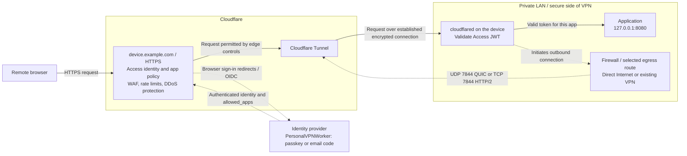
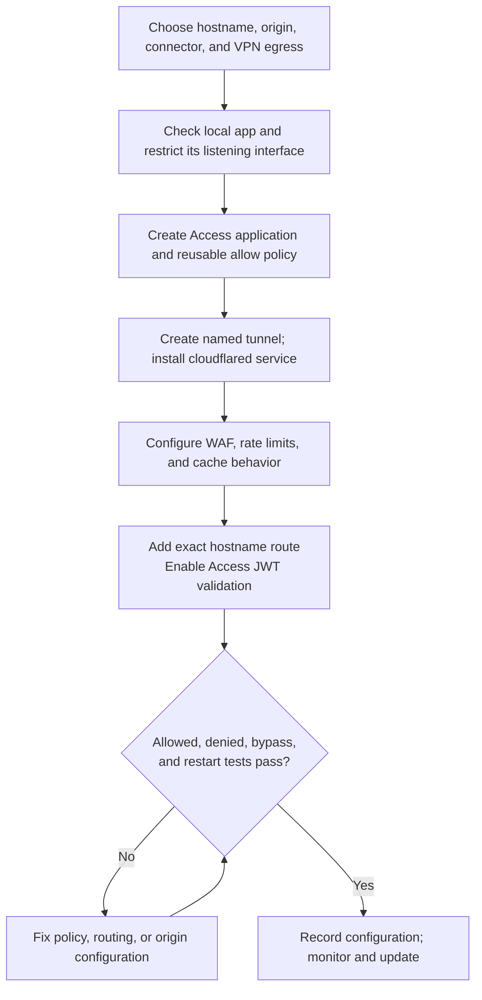
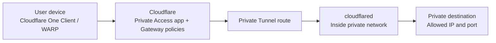

# Expose a private service to authenticated users

This runbook connects a web application on the secure side of an existing VPN/firewall to Cloudflare Access using `cloudflared`. It includes the WAF, origin firewall, identity, and operational controls needed around that connection. Documentation checked November 6, 2026; this is a setup procedure, not verification of a live deployment.

The access requirement is: **a user must authenticate and have permission for the selected service before traffic reaches that service through the published endpoint**. Access makes that decision; Tunnel delivers the permitted traffic to the configured origin address and port. WAF adds HTTP request filtering. The existing VPN describes where the origin lives; joining it is not part of this user sign-in flow.

The main example assumes a Linux device, such as a Raspberry Pi, with an application at `http://127.0.0.1:8080`, published as `https://device.example.com`. Replace these examples with your own values. Use the existing PersonalVPNWorker as the identity provider, or substitute another configured IdP.

Confirm the service protocol before choosing the client connection method. HTTP(S) services use the browser/public-hostname flow below and are supported by the current automation. SSH and other TCP services can use client-side `cloudflared` with Access authentication or private routing through Cloudflare One Client. UDP needs an appropriate private network route/client. Those private-protocol workflows are separate from the current HTTP(S) provisioner; WAF does not inspect their protocol payloads. See [Tunnel protocol support](https://developers.cloudflare.com/tunnel/concepts/routing/#supported-protocols).

**Access runs at Cloudflare; `cloudflared` runs inside your network.** Tunnel establishes outbound connections, so the application needs no WAN port forward or publicly routable origin address. This is an additional authorized route to one application: users do not have to join your existing VPN first. If VPN membership must also be required, use the restricted alternatives below. See [Cloudflare connectivity options](https://developers.cloudflare.com/cloudflare-one/networks/connectivity-options/).

## Traffic flow and trust boundaries



Solid arrows show the application request. Dotted arrows show authentication or connection establishment; responses return along the request path. The edge box groups controls conceptually, without asserting an Access/WAF execution order. The tunnel carries requests back over connections that the device opened; it does not open an inbound firewall port.

Browser HTTPS terminates at Cloudflare so it can apply HTTP security controls. The Cloudflare-to-connector connection is encrypted separately. The final connector-to-application hop uses the protocol you configure: HTTP is appropriate for this loopback example; use verified HTTPS when crossing a LAN or VPN to a different host. See [origin TLS settings](https://developers.cloudflare.com/cloudflare-one/networks/connectors/cloudflare-tunnel/configure-tunnels/origin-parameters/).

| Component | Responsibility | Boundary |
| --- | --- | --- |
| Access | Authenticate users and authorize the exact application | Does not install software or provide routes by itself |
| PersonalVPNWorker / IdP | Establish identity; this project also issues `allowed_apps` | Does not proxy application traffic or configure the VPN |
| WAF and rate limiting | Inspect and limit HTTP requests to the proxied hostname | Do not filter arbitrary SSH, RDP, or private-network packets |
| Tunnel / `cloudflared` | Carry traffic from Cloudflare to a reachable private service | A healthy tunnel does not prove Access policies are correct |
| Existing VPN and firewalls | Preserve existing network access and restrict origin/connector reachability | Direct LAN/VPN connections can bypass Cloudflare |
| Application | Enforce its own users, roles, and data permissions | Access login does not automatically sign into the application |

## Setup sequence



### 1. Choose the service and network path

Record the Cloudflare account/zone, public hostname, IdP, allowed users, origin address/port, connector host, and recovery path. Confirm a Cloudflare Zero Trust organization and an active Cloudflare-managed DNS zone already exist. This example uses a full DNS setup and a single-level subdomain covered by the zone's certificate.

Run `cloudflared` on the application device when practical. Otherwise, use a dedicated connector that can reach only the necessary destination ports. With containers, `127.0.0.1` refers to the connector's own network namespace; use a private container network and service name if the app is in a different container.

On the intended Linux connector, inspect the network and application:

```sh
ip route
ip rule
ss -lnt
curl --fail --show-error --output /dev/null http://127.0.0.1:8080/
```

Adapt the last command to the app's health endpoint and expected status. Confirm internal name resolution and the real route to a remote origin if it is not on this device.

Allow outbound **UDP 7844 for QUIC and TCP 7844 for HTTP/2** to Cloudflare's documented tunnel destinations. Allow the required DNS resolution, clock synchronization, and HTTPS destinations for package installation and Access JWT key retrieval. Use the current [Tunnel firewall destination list](https://developers.cloudflare.com/cloudflare-one/networks/connectors/cloudflare-tunnel/configure-tunnels/tunnel-with-firewall/) rather than a copied IP list. TCP 443 alone does not carry the tunnel.

If the device has a full-tunnel VPN client, tunnel connections follow its routing and firewall rules. Decide whether they must go through that VPN or use an intentional direct-egress exception. A VPN kill switch can block `cloudflared`; a direct-egress exception changes that security boundary. If VPN-only egress is required, enforce it in the firewall and test VPN failure: the connector must not reconnect through an unintended default route. Merely ordering services at boot does not enforce this.

For the same-device example, bind the app to loopback. For a separate origin, restrict its service port to the connector host(s), use HTTPS with a trusted certificate, and restrict the connector's reach into the LAN. Preserve a working administrative recovery route while changing firewall rules. Remove alternate public ingress, including old forwards, public IPv6 listeners, and alternate hostnames that reach the same service without equivalent protection.

### 2. Create Access protection before publishing the route

In **Zero Trust → Access controls → Applications**, create a **Self-hosted and private** application with public hostname `device.example.com`. Protect the whole hostname initially. Select the intended IdP and a suitable session lifetime. Create a reusable Allow policy under **Access controls → Policies** and attach it to this application; unmatched users are denied. See [public application setup](https://developers.cloudflare.com/cloudflare-one/access-controls/applications/http-apps/self-hosted-public-app/) and [reusable policy management](https://developers.cloudflare.com/cloudflare-one/access-controls/policies/policy-management/).

For **this repository's IdP**, follow [Access setup](access-setup.md) and [per-user permissions](app-permissions.md). The policy needs both:

| Rule | Value |
| --- | --- |
| Include: Login Methods | The managed PersonalVPNWorker OIDC provider |
| Require: OIDC claim | `allowed_apps` contains `device.example.com`, from that same provider |

Ensure the provider imports `allowed_apps`, the app hostname is in the project's application configuration, and the intended family users receive an explicit grant. New family accounts and new applications have no automatic grants. A login-method-only policy would admit every active member of this IdP. For another IdP, use its verified users/groups and appropriate MFA/device requirements instead.

Review every policy on the application, including more-specific path applications. Remove unintended alternative Allow or Bypass paths. For automation, use a separate, narrowly scoped Service Auth policy and service token; the tunnel token is not an application credential. Access evaluates Bypass and Service Auth before ordinary Allow/Block policies, so rule placement alone cannot neutralize an unintended bypass. See [Access policy behavior](https://developers.cloudflare.com/cloudflare-one/access-controls/policies/).

Copy the application's **AUD** value for connector validation. Keep the identity portal's OIDC endpoints reachable without depending on their own Access login, to avoid an authentication loop.

**Automated setup:** `npm run access:plan` previews the desired reusable policies offline; `npm run access:inspect` reads the account and identifies migrations before `npm run access:apply`. The script converts owned legacy policies in place, preserves their IDs/attachments, and verifies policy readback. The separate `network:plan`, `network:inspect`, and `network:apply` commands provision a named tunnel, verified Access audiences, proxied DNS, hostname-scoped security/cache rules, and a protected Linux installation bundle. Follow [network provisioning](network-setup.md) for configuration and commands. Choose one configuration owner and serialize dashboard/CLI edits. Origin binding, VPN routing, and host firewall choices still require the device-specific steps above.

### 3. Install the connector as a persistent service

Create a named, remotely managed tunnel under **Networking → Tunnels**. Choose the connector OS/architecture, but do not publish an unprotected application during setup. A tunnel without a published route can connect safely while you finish protection. See [dashboard tunnel setup](https://developers.cloudflare.com/cloudflare-one/networks/connectors/cloudflare-tunnel/get-started/create-remote-tunnel/).

For Debian/Ubuntu/Raspberry Pi OS, use Cloudflare's current stable package repository. The following commands are for the target Linux device, not the development Mac:

```sh
sudo mkdir -p --mode=0755 /usr/share/keyrings
curl -fsSL https://pkg.cloudflare.com/cloudflare-main.gpg \
  | sudo tee /usr/share/keyrings/cloudflare-main.gpg >/dev/null
echo 'deb [signed-by=/usr/share/keyrings/cloudflare-main.gpg] https://pkg.cloudflare.com/cloudflared any main' \
  | sudo tee /etc/apt/sources.list.d/cloudflared.list
sudo apt-get update
sudo apt-get install cloudflared
cloudflared --version
```

Check the supported distribution/architecture against the [official package instructions](https://pkg.cloudflare.com/). Then run the dashboard's service-install command with the token for this tunnel:

```sh
# Replace the placeholder privately; it is a connector credential.
sudo cloudflared service install 'REPLACE_WITH_TUNNEL_TOKEN'
sudo systemctl enable --now cloudflared
systemctl is-active cloudflared
systemctl is-enabled cloudflared
```

Keep the token out of source control, shared terminals, and diagnostic attachments; the standard installer can persist it in the service definition. For deployments that must avoid token command-line arguments, use a protected file with `cloudflared tunnel run --token-file /path/to/token` in your service manager; this requires version 2025.4.0 or later. See [run parameters](https://developers.cloudflare.com/tunnel/reference/run-parameters/). A remotely managed connector does not need an account-wide `cloudflared tunnel login` certificate on the device.

If the host already runs `cloudflared`, inspect its ownership and routes before installing another service. Reuse or deliberately extend the existing configuration; do not overwrite a connector serving other applications. Confirm the intended tunnel is healthy in the dashboard.

### 4. Configure WAF and HTTP behavior

WAF settings belong to the DNS zone's application security configuration; Access and Tunnel configuration alone do not select your desired WAF rules. Review the capabilities available on that zone's plan. [Cloudflare WAF](https://developers.cloudflare.com/waf/) provides managed rules, custom rules, and rate limiting for HTTP applications.

| Control | Starting configuration for this app |
| --- | --- |
| Managed WAF rules | Enable the applicable available rulesets; test the app's normal requests and tune specific false positives |
| Custom rules | Scope new rules to hostname `device.example.com`; add only restrictions supported by the app's requirements |
| Rate limits | Scope to that hostname and expensive/login/API paths; select thresholds from actual usage and test shared-IP clients |
| Bot controls | Test browser, API, mobile, Git, and WebSocket clients before adding challenges; a service token does not automatically bypass bot/WAF checks |
| HTTPS | Require browser HTTPS and a valid edge certificate; retain verification on any HTTPS origin hop |
| Caching | Set a Cache Rule to bypass caching for this private hostname initially; retain appropriate application `Cache-Control` headers |

Avoid blanket WAF Skip rules or IP Allow rules as an authentication workaround. Tune only the affected hostname/path/rule after reviewing Security Events. DDoS protection is automatic, while the specific WAF/rate-limit behavior depends on enabled rules and plan. Cloudflare documents the security rules' order as HTTP DDoS, custom rules, rate limiting, managed rules, then Super Bot Fight Mode. Bot Fight Mode is separate and cannot be skipped with a custom rule. See [security feature interactions](https://developers.cloudflare.com/waf/feature-interoperability/).

These controls inspect requests reaching the Cloudflare hostname. They do not protect a direct LAN/VPN request or inspect the contents of arbitrary non-HTTP sessions. Do not apply interactive challenges indiscriminately to the IdP's discovery, token, or JWKS endpoints: those also have machine clients.

### 5. Publish the hostname and validate Access at the connector

In the tunnel's **Routes** tab, add a **Published application** route:

| Setting | Example |
| --- | --- |
| Public hostname | `device.example.com` |
| Service URL | `http://127.0.0.1:8080` |
| Protect with Access | Enabled |
| Access team | Your existing team name |
| Access audience | This application's AUD |

Configure **Protect with Access** in the route's origin settings so `cloudflared` validates the Access assertion before forwarding the request. Use this app's audience, not the launcher's audience. This complements the edge policy and does not protect a separate direct connection to the origin. See [Access origin validation](https://developers.cloudflare.com/cloudflare-one/networks/connectors/cloudflare-tunnel/configure-tunnels/origin-parameters/#access).

For a different-host HTTPS origin, configure the expected **Origin Server Name** and, if needed, **CA Pool**; keep TLS verification enabled. Set the HTTP Host Header only if the origin's virtual-host routing requires it. Fix certificate trust/name errors instead of enabling `noTLSVerify`.

With full Cloudflare DNS, adding the route creates the DNS record. Verify that the exact hostname maps to the intended tunnel and stays proxied; do not point it at the device's public IP. Resolve existing DNS conflicts deliberately. Check local DNS overrides too: if `device.example.com` resolves directly to a LAN address inside the VPN, those requests never encounter the edge protections. See [route creation](https://developers.cloudflare.com/cloudflare-one/networks/connectors/cloudflare-tunnel/get-started/create-remote-tunnel/).

## Verification and operation

Test from an external connection, such as cellular, and from inside the LAN/VPN. Keep the origin restricted while testing.

| Test | Expected result |
| --- | --- |
| Private browser, no Access session | Login or denial; no private application content |
| Authorized account and explicit app grant | Direct application URL succeeds after authentication |
| Valid family account without this app's grant | Denied even when navigating directly to the URL |
| Missing/invalid assertion through connector | Rejected by connector validation; never forwarded to the app |
| Direct origin port from another network host | Blocked unless a separately documented trusted path intentionally permits it |
| Alternate hostname, public IPv4/IPv6, local DNS override | No unintended route around the same protection |
| Normal API/WebSocket/upload operations | Work under intended Access and WAF policies |
| Temporary WAF Block rule for an exact test path on this hostname | Request is blocked and visible in Security Events; remove the test rule afterward |
| Service restart and device reboot | Connector returns healthy and authorized access works |
| VPN disconnect/reconnect | Matches the chosen egress policy, including fail-closed behavior when required |

To test connector rejection safely, use an isolated test hostname with no edge Access app and route it to a disposable local test listener, while requiring the real application's AUD at the connector. An unauthenticated request must fail and the listener must see no request. Remove that test route and DNS record afterward. Do not remove protection from the real application to perform this test.

Use Access authentication logs for identity/policy decisions, zone Security Events for WAF/rate limits, and connector logs for transport/origin failures. For the Linux service, inspect `sudo journalctl -u cloudflared --since '15 minutes ago'` locally and redact credentials before sharing output. A healthy tunnel plus an origin error usually calls for checking the configured service URL, listening port, Host header, and TLS trust.

Record the owner, hostname, origin, tunnel ID, connector hosts, Access application/AUD, reusable policy IDs, WAF rules, and update/recovery procedure. Keep secrets separately. Patch the OS, app, and connector; schedule package updates and service restarts. For availability, use multiple connectors on separate hosts only when each can reach the intended origin; `localhost` routes must refer to an equivalent app on every connector.

When removing a user's app grant, also revoke affected Cloudflare Access sessions when immediate removal is required, and end application-local sessions where relevant. Local grant changes do not invalidate already-issued external sessions; see [permission/session boundaries](app-permissions.md#changing-permissions-and-existing-sessions).

For rollback or decommissioning, first stop forwarding the hostname (remove its published route, or stop a dedicated connector), confirm the service is unreachable through that path, then remove its DNS record. Retain Access protection until no public route remains. On shared tunnels, remove only this application's route. Restore prior DNS/routing only if the former destination has equivalent protection. Revoke/rotate connector credentials when retiring a connector; never “roll back” by deleting Access while leaving the application published.

## If VPN membership or private protocols are required

The browser design above adds a Cloudflare-controlled entry point. Existing VPN clients that connect directly to the origin follow a separate trust path. Choose explicitly whether to retain that path or force access through the protected hostname.

| Requirement | Design |
| --- | --- |
| Browser access to one private web app with WAF | Use the public-hostname runbook above; no client VPN software is required |
| Browser access must also originate through the existing VPN | Route the public hostname through that VPN and add its dedicated public egress IPs as an Access **Require** condition alongside identity; test off-VPN denial. Cloudflare sees public egress IPs, not the client's private VPN address. This proves source egress, not a particular VPN session |
| No public application hostname; private IP/hostname or TCP/UDP access | Use Cloudflare One Client (WARP) on user devices with private Tunnel routes, private Access applications, and Gateway policies |
| Retain only the existing VPN for direct service access | Keep the origin private and enforce VPN/firewall/application controls; an Access app alone cannot intercept direct VPN packets |

For the private-routing variant:



Start with the smallest destination route, such as a single IPv4 `/32`, and restrict the application's ports. Configure client enrollment, matching split-tunnel routing, private Access policies, and private DNS resolution when using hostnames. Routing alone is not authorization. Gateway supplies network/HTTP controls on this path; the public zone WAF does not automatically inspect private routed traffic. See [private Access applications](https://developers.cloudflare.com/cloudflare-one/access-controls/applications/non-http/self-hosted-private-app/).

If WARP and the existing VPN run on the same client, explicitly divide route and DNS ownership. For a small private-app deployment, an Include profile can limit WARP to the selected destinations; remove those destinations from the other VPN's routing responsibility. Test overlap, DNS, and reconnect behavior using [VPN coexistence guidance](https://developers.cloudflare.com/cloudflare-one/team-and-resources/devices/cloudflare-one-client/deployment/vpn/). SSH/RDP need their supported Access/client workflow; HTTP WAF rules do not secure their protocol payloads.
