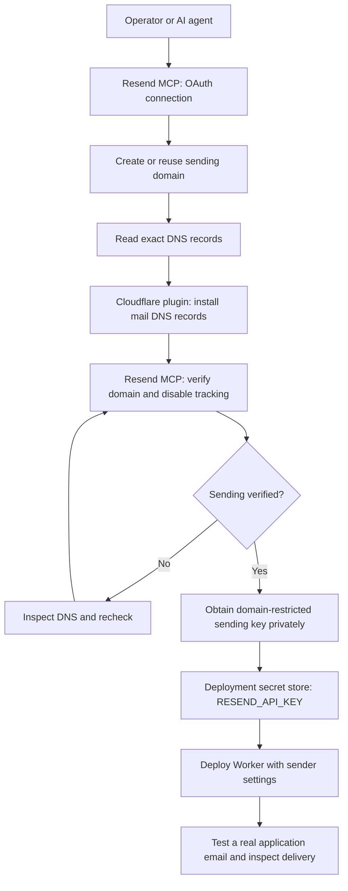
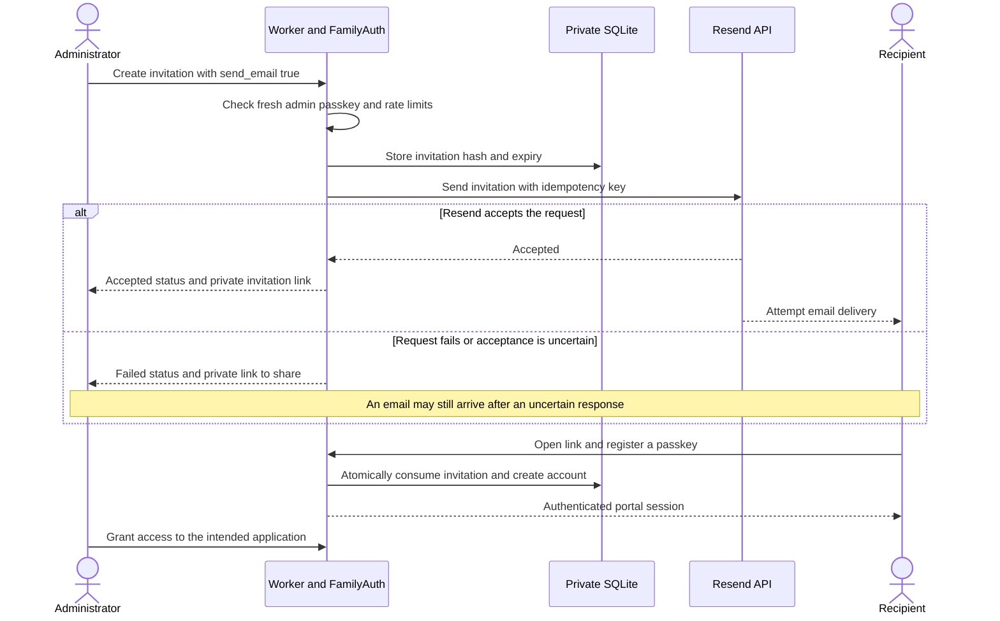
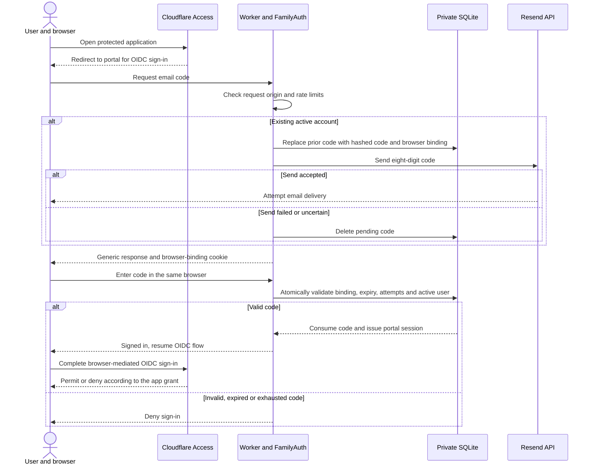

# Resend setup and email flows

Resend delivers this portal's invitations, email sign-in codes, and account-security notifications. The AI agent uses **Resend MCP to configure and inspect the email service**. At runtime, the Worker sends directly to the Resend HTTPS API using its own restricted `RESEND_API_KEY`. Neither MCP nor the device's `cloudflared` connector sits in the runtime email path.

For agent-assisted setup, use the [README's YOLO prompt](../README.md#yolo-setup-with-an-ai-agent). The repository's `access:*` and `network:*` scripts do not provision Resend; the agent performs the email setup below through the connected tools.

## Sender setup

1. Install/connect the Cloudflare plugin and Resend MCP as described in the [README](../README.md#yolo-setup-with-an-ai-agent). Resend's hosted MCP endpoint is `https://mcp.resend.com/mcp`; complete OAuth and verify the intended workspace. Reuse an existing connection. See [Resend MCP setup](https://resend.com/docs/mcp-server).
2. Use Resend MCP to find or create the sending domain. For a new installation, use a dedicated subdomain such as `mail.example.com`, with a sender such as `invites@mail.example.com`. See [verified domains](https://resend.com/docs/dashboard/domains/introduction).
3. Retrieve that domain's actual DNS records from Resend. Use the Cloudflare plugin to add its DKIM and SPF/return-path records with the exact names, values, and priorities. Preserve existing mail routes, SPF, and DMARC records; reconcile conflicts instead of replacing them. Mail authentication records use DNS-only resolution, separate from the proxied application hostname. This application needs sending, so do not enable inbound receiving or replace the domain's existing mailbox MX records. See [Resend's Cloudflare DNS guide](https://resend.com/docs/guides/dns/cloudflare).
4. Request verification through Resend MCP, then read the domain until sending is verified. A pending verification request is not a successful verification. Disable open and click tracking for the sending domain so private invitation links are not rewritten or tracked.
5. Create or reuse a **sending-only API key restricted to that domain**. Obtain it through private credential entry or a secret manager. MCP OAuth credentials are separate from this runtime key. See [Resend API key management](https://resend.com/docs/dashboard/api-keys/introduction).
6. Configure the deployment settings below and deploy through the existing workflow. For GitHub Actions, store the key as a repository secret; the workflow uploads it privately to the Worker. For a locally managed deployment, use Wrangler's interactive secret input for the existing Worker. Never put a key in source, a command-line argument, or a shared transcript.

| Setting | GitHub Actions | Direct Worker deployment |
| --- | --- | --- |
| `RESEND_API_KEY` | Repository secret | Worker secret |
| `RESEND_FROM` | Repository variable; bare address on verified domain | Deployment setting or Worker secret |
| `RESEND_REPLY_TO` | Optional repository variable; monitored bare address | Optional deployment setting or Worker secret |
| `PUBLIC_ORIGIN` | Existing production HTTPS origin | Existing production HTTPS origin |

For an existing Worker with `.env.deploy.local` configured:

```sh
npm run configure
npx wrangler secret put RESEND_API_KEY --config wrangler.deploy.json --env ""
```

Enter the key at the private prompt. Apply sender settings through your normal deployment workflow. Supplying no key in a later GitHub deployment preserves the existing Worker secret. The UI enables email only when the key and a valid sender are configured and `PUBLIC_ORIGIN` uses HTTPS; it does not independently confirm domain verification or key validity.



## Invitation and enrollment

An administrator verifies a passkey within the last five minutes, then selects **Create and email invitation**. The Worker stores a hash of a single-use invitation and sends its private link through Resend. The first-administrator bootstrap remains manual.



The link carries the invitation token in its URL fragment. The browser removes it from history after loading; opening a link alone does not consume the invitation. Enrollment requires explicit passkey registration, and invitations expire according to `INVITE_TTL_SECONDS`. New family accounts have no app grants; enrollment does not by itself authorize the protected service. See [application permissions](app-permissions.md).

## Email-code sign-in

An already enrolled, active user can select **Email me a sign-in code**. Pending invitees must enroll first. These codes come from this Worker through Resend; they are separate from Cloudflare Access's own one-time-PIN login method.



Codes last ten minutes, can be used once, and allow five guesses. A new request replaces the previous code. Verification requires the requesting browser's HttpOnly cookie, and account availability is not disclosed in the request response. Codes, cookie bindings, and sessions are stored as hashes; raw codes are excluded from responses, URLs, subjects, and application logs. The [README](../README.md#email-code-sign-in-embedded-browsers-and-conduit) lists the request limits and remembered-session behavior.

Email sign-in creates a portal session; Cloudflare Access still checks the service's `allowed_apps` claim. The permitted request then follows the [Access and Tunnel flow](device-access-tunnel.md). Email sign-in does not replace the fresh passkey required for administrative changes.

## Security notifications and recovery

Account-security changes record an event and attempt a notification through the same Resend sender. The event records whether the request was accepted, failed, or email was unconfigured. A notification failure does not roll back the completed security change. Alerts contain no invitation token or sign-in code.

Email recovery is off by default and requires prior opt-in by a family member using a fresh passkey. It permits adding a replacement passkey after recent email sign-in. Administrators cannot use mailbox-only recovery. See [passkeys and account recovery](../README.md#passkeys-and-account-recovery) for the exact rules.

## Verification and failure handling

- **Test the deployed application:** with an explicitly authorized recipient, either invite a new test user or request a code for an existing active test account. Sending directly through MCP alone does not verify the Worker's key, sender settings, or application flow. Complete enrollment/sign-in in the user's browser; keep tokens and codes private.
- **Check delivery separately:** inspect the message and delivery events through Resend MCP or the Resend dashboard. This implementation does not persist the provider's message ID; correlate using recipient and send time privately. `accepted` in the portal means the API accepted the request. Resend's delivered status means the recipient mail server accepted the message, which can still be filtered into spam or quarantine; confirm receipt with the test recipient. See [Resend delivery troubleshooting](https://resend.com/guides/email/users-never-got-login-code).
- **Check denial behavior:** pending invitations, unknown addresses, and disabled accounts cannot use email-code sign-in. A signed-in user without an app grant must still be denied by Access. Run automated negative cases locally; do not generate unsolicited email to real addresses.
- **Handle retries:** sends have a ten-second timeout per attempt and at most one retry for network errors, HTTP 429, or 5xx, with the same idempotency key and payload. A failed or ambiguous invitation send retains the private link for manual delivery. A failed or ambiguous sign-in send deletes the pending code, so a late-arriving code will not work; request another after the rate limit permits it.
- **Know the remaining limits:** there is no durable application delivery queue or delivery/bounce webhook consumer. Application logs record outcomes and failed provider status codes, excluding recipients and message contents. Use Resend to investigate delivery; do not enable link tracking as a debugging workaround.

Implementation references: [email delivery](../src/email.ts), [email-code login](../src/email-login.ts), [invitation routes](../src/auth.ts), and [account-security notifications](../src/account.ts).
